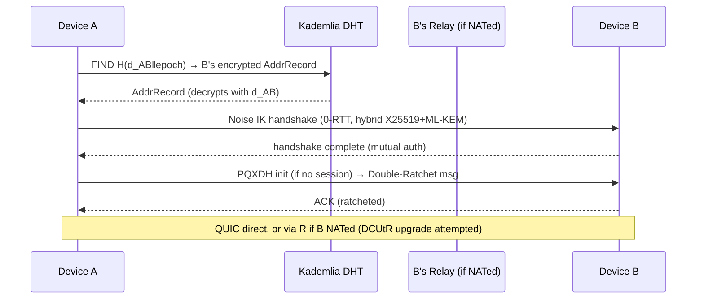
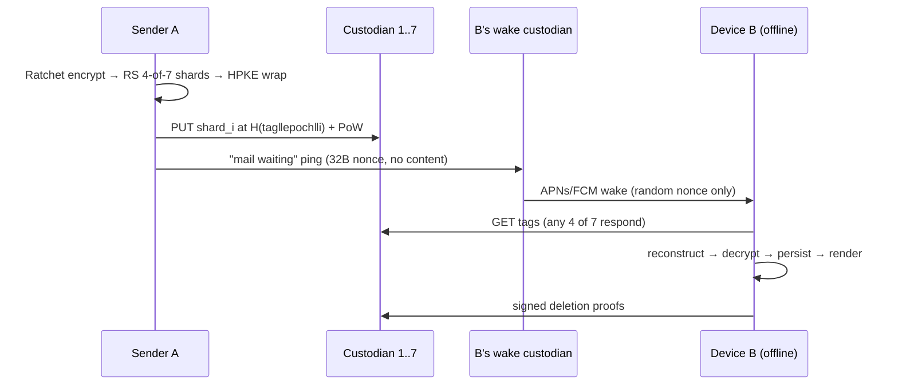
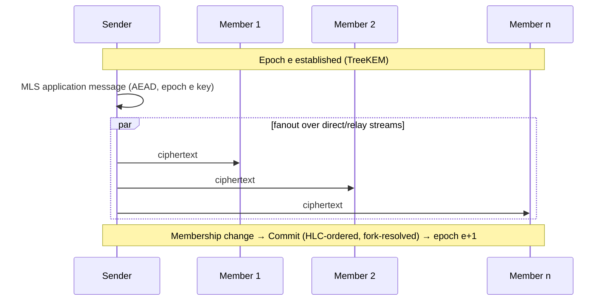
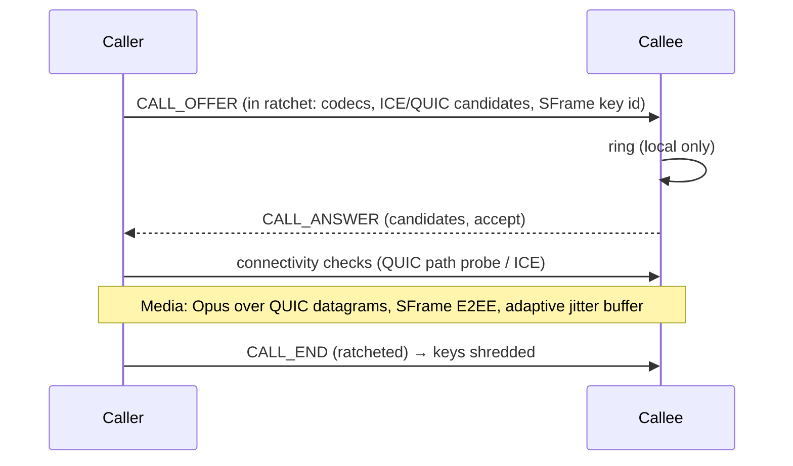
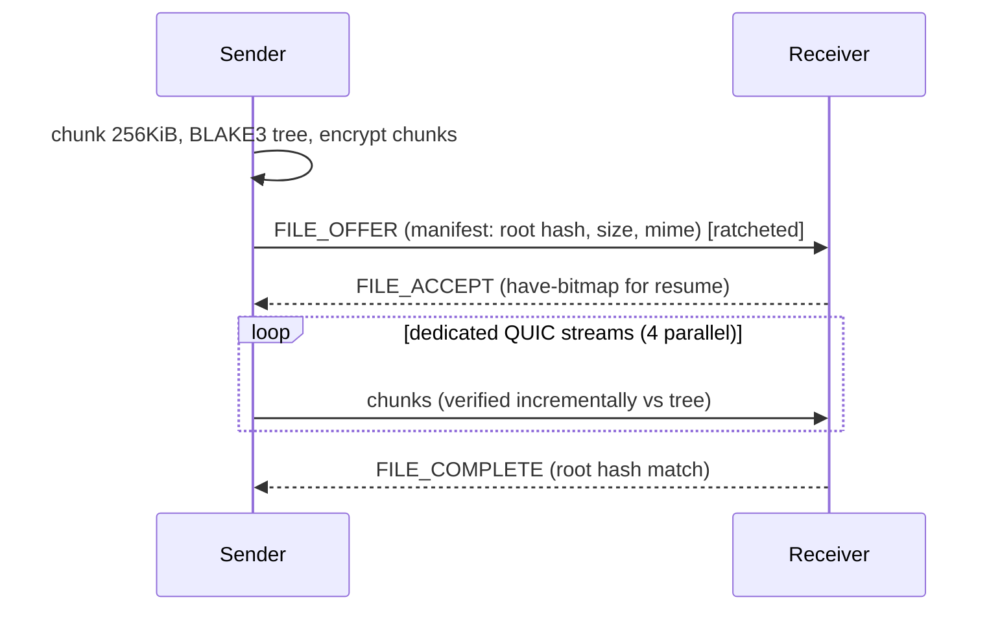

# AEGIS Protocol
## A Serverless, Censorship-Resistant, Privacy-First Messaging Platform
**Architecture Document v1.0 — Audience: Senior Distributed Systems Engineers, Cryptographers, Rust Developers**

---

# 1. Executive Summary

AEGIS is a fully serverless messaging platform built on a hardened libp2p overlay with a Sybil-resistant Kademlia DHT, QUIC-native transport, hybrid post-quantum end-to-end encryption (X25519 + ML-KEM-768), Double Ratchet for 1:1 sessions, MLS for groups, and a decentralized erasure-coded mailbox layer for offline delivery. There are **no application servers**. The only infrastructure that exists is (a) bootstrap nodes — which are replaceable, federated, and non-privileged — and (b) volunteer relay/mailbox nodes run by the same user devices that use the network (every desktop node is a potential relay; mobile nodes are consumers only).

**Core architectural theses:**

1. **No privileged nodes.** Any node that can be shut down, subpoenaed, or compromised must be replaceable by any other node. Bootstrap nodes only answer "how do I join?" — they see no messages, no social graph, no routing of user content.
2. **Content and metadata are separate problems.** Content is solved with modern E2EE (Ratchet/MLS). Metadata is the harder problem: we minimize it via sealed-sender-style mailbox addressing, cover traffic budgets, padded envelopes, and the fact that mailbox nodes store *opaque, addressed-to-nobody* blobs.
3. **Mobile is a second-class citizen by physics, not by design.** Phones cannot hold DHT slots or relay for others (battery/NAT). The architecture explicitly splits the overlay into **full nodes** (desktop/servers/always-on) and **leaf nodes** (mobile), with leaf nodes delegating availability to a self-selected set of mailbox custodians via erasure coding — no single custodian can read or censor a message.
4. **Post-quantum from day one, but hybrid.** Pure PQ is not yet trustworthy alone; pure ECC is harvest-now-decrypt-later vulnerable. Every handshake is X25519+ML-KEM-768 (X-Wing-style combiner). Signatures remain Ed25519 with an ML-DSA upgrade path via key-agility in the identity layer.
5. **CRDTs, not consensus.** Message sync, multi-device state, and group membership are convergent replicated data types. Consensus (Raft/Paxos/blockchain) is categorically rejected: it requires coordination, leaks timing, and cannot survive partition — the exact opposite of our goals.

**Why this surpasses the incumbents (one-line each, expanded in §15):**
- **Signal**: no central server, no phone number, PQ-hybrid from genesis, metadata-minimized offline delivery.
- **SimpleX**: we keep their "no user identifiers" insight but replace fixed queues with a DHT-addressed erasure-coded mailbox mesh — no queue operator can correlate or censor.
- **Session**: no blockchain, no staking, no 3-hop-onion latency tax on calls; onion routing is an *optional per-conversation* privacy tier, not a mandatory global one.
- **Matrix**: no homeservers, no server-side room state replication, no federation metadata spray.
- **Briar**: we keep Briar's transport-agnostic sync philosophy but add global-scale DHT discovery and real-time calls (Briar has neither).
- **Tox**: we fix Tox's actual weaknesses — unauthenticated DHT, no forward secrecy in group chats, no multi-device, IP leakage to peers — with authenticated DHT records, MLS groups, and relay-mediated address privacy.
- **Telegram/WhatsApp**: not comparable on trust model; included for completeness.

---

# 2. Complete System Architecture

## 2.1 Layered Stack

```
┌─────────────────────────────────────────────────────────────────┐
│ L7  APPLICATION     Flutter UI (Dart) — renders, captures media │
├─────────────────────────────────────────────────────────────────┤
│ L6  API / FFI       flutter_rust_bridge — async event streams   │
├─────────────────────────────────────────────────────────────────┤
│ L5  SERVICES        messaging, groups, calls, files, presence,  │
│                     sync engine, backup, pairing, notifications │
├─────────────────────────────────────────────────────────────────┤
│ L4  PROTOCOL        wire envelopes (protobuf), versioning,      │
│                     session management, ratchet/MLS state mach. │
├─────────────────────────────────────────────────────────────────┤
│ L3  CRYPTO          Noise, Double Ratchet (PQXDH), MLS, HPKE,   │
│                     AEAD, KDFs, signatures, CSRNG               │
├─────────────────────────────────────────────────────────────────┤
│ L2  OVERLAY         Kademlia DHT, GossipSub, rendezvous,        │
│                     mailbox mesh, relay manager, peer store     │
├─────────────────────────────────────────────────────────────────┤
│ L1  TRANSPORT       QUIC (primary), WebRTC (NAT/browser),       │
│                     TCP+Noise (fallback), BLE/WiFi-Direct/mDNS  │
├─────────────────────────────────────────────────────────────────┤
│ L0  PLATFORM        SQLite/SQLCipher, OS keystore, net sockets, │
│                     wakers (FCM/APNs wake-only), power manager  │
└─────────────────────────────────────────────────────────────────┘
```

## 2.2 Node Classes

| Class | Role | DHT | Relay | Mailbox | Typical device |
|---|---|---|---|---|---|
| **Full node** | Participates in overlay routing | Yes (server mode) | Yes (Circuit Relay v2) | Yes (volunteer, quota'd) | Desktop, always-on laptop, RPi, user-run VPS |
| **Leaf node** | Consumer only | Client mode | No | No (publishes/fetches) | Android, iOS |
| **Bootstrap node** | Peer introduction only | Yes (well-known) | Optional | No | Federated, community-run, hardcoded + DNS + LAN-discovered |

Bootstrap nodes are **not trusted**: their only function is returning Kademlia `FIND_NODE` results. A malicious bootstrap can at worst partition a *new* node, mitigated by (a) ≥8 bootstrap sources from disjoint operators, (b) cached peer store from prior sessions, (c) LAN/mDNS and Bluetooth bootstrap, (d) QR/manual peer injection.

## 2.3 The Availability Delegation Principle (key innovation)

The fundamental problem of serverless mobile messaging: **the recipient is usually offline.** Signal solves it with a server; SimpleX with queues; Session with a swarm. AEGIS solves it with **threshold-erasure mailbox custody**:

- Sender splits an encrypted message blob into `k-of-n` Reed–Solomon shards (default 4-of-7).
- Each shard is stored under an **unlinkable, per-message content address** `H(recipient_mailbox_tag || epoch || counter)` at `n` distinct DHT nodes chosen by deterministic-but-secret rendezvous hashing.
- Each shard is individually encrypted (HPKE) to the recipient's mailbox key, so custodians store opaque bytes.
- No custodian knows: the sender, the recipient, the message content, or that the other 6 custodians exist.
- Recipient (or recipient's other devices) polls its mailbox tags when online, fetches any 4 shards, reconstructs, decrypts, and issues deletion proofs.
- Custodians are compensated only by reciprocity (tit-for-tat storage quotas, BitTorrent-style) — no cryptocurrency, no token economics.

This gives SimpleX-level unlinkability without SimpleX's fixed queue operators, and Session-level offline delivery without a blockchain.

---

# 3. Detailed Module Breakdown (All 50 Required Areas)

## 3.1 Network Architecture

**Selected: libp2p (rust-libp2p) as the overlay framework, with a custom transport stack and several replaced subsystems.**

Justification and alternatives:

| Candidate | Verdict | Reasoning |
|---|---|---|
| **libp2p** | ✅ Adopt (framework) | Modular transports, mature Kademlia/GossipSub/identify/relay implementations, Rust implementation is production-grade (used by IPFS, Filecoin, Ethereum). We adopt the *framework* but harden/replace: custom DHT record authentication, custom relay quota manager, custom connection gating. |
| Raw QUIC + custom overlay | ❌ Rejected | 2–3 years of re-implementing what libp2p already does well; higher audit surface. |
| Yggdrasil/cjdns-style routed overlay | ❌ Rejected | Global routing overlays leak topology and have poor mobile story; we need a DHT, not a routed mesh. |
| Tor as transport | ⚠️ Optional pluggable transport | Available as a privacy tier (see §9.10), not default: latency breaks calls, and Tor exit/bridge dynamics don't fit p2p dialing. |

**Transport selection:**

| Transport | Role | Why |
|---|---|---|
| **QUIC (quinn, via libp2p-quic)** | Primary (≥90% of traffic) | 0-RTT resumption, native multiplexing (no HOL blocking), connection migration across network switches (WiFi↔LTE — *critical for mobile*), userspace congestion control, mandatory TLS 1.3. |
| **WebRTC (datachannel)** | Secondary | Best-in-class ICE hole punching; required for any future browser client; useful when symmetric NAT defeats QUIC punching. |
| **TCP + Noise** | Fallback | Censoring networks that block UDP; also the transport over Tor. |
| **UDP raw** | Only inside QUIC/DTLS | Never unencrypted. |
| **BLE / WiFi-Direct / mDNS** | Local tier | Internet-independent sync (Briar-style), disaster resilience, local pairing. |

TCP vs QUIC: TCP's HOL blocking and head-of-line retransmission stalls are fatal for multiplexed messaging+calls; QUIC streams fix this. TCP is retained only because some captive/censoring networks are TCP-443-only.

## 3.2 Peer Discovery

Four tiers, tried in order of preference:

1. **Peer store cache** (persistent, from prior sessions) — fastest, works when DHT is unreachable.
2. **Kademlia DHT lookup** of the peer's *current* rendezvous record (see 3.5) — the default.
3. **Rendezvous points**: peers register under rotating, HMAC-derived rendezvous tags at DHT nodes near the tag's key. This replaces libp2p's public rendezvous (which leaks who is looking for whom).
4. **Bootstrap fallback + gossip-learned peers** via GossipSub peer exchange (PX) on subscribed topics.

Critically, **users are not looked up by identity key directly** (that would let anyone enumerate when a user is online). Instead, contacts share a pairwise **discovery secret** `d_AB` (established at contact exchange); each side publishes its address record under `H(d_AB || day_epoch)` — only the contact can find you. Strangers cannot enumerate users. This is the SimpleX insight applied to a DHT.

## 3.3 NAT Traversal

Layered strategy, in order:

1. **AutoNAT v2** determines reachability (public / NATed / symmetric).
2. **UPnP/NAT-PMP/PCP** port mapping attempted first (cheap, low latency).
3. **Direct connection via DCUtR (Direct Connection Upgrade through Relay)**: connect via Circuit Relay v2, exchange observed addresses, attempt simultaneous QUIC hole punch, migrate the connection off the relay. QUIC's connection migration makes this upgrade *seamless* — the relayed stream continues while the direct path is probed.
4. **ICE (via WebRTC stack)** for symmetric NAT cases where DCUtR's birthday-paradox punching fails.
5. **Permanent relay** as last resort (see 3.4).

Measured expectation (from libp2p/IPFS production data): ~75–85% of peer pairs achieve direct connectivity; the rest stay relayed.

## 3.4 Relay Strategy

**Circuit Relay v2 (not v1)** — v2 is resource-limited by design (128 concurrent reservations, 2-minute/128KiB data caps by default), which we extend:

- **Reservation quotas** enforced per-identity-key with proof-of-work-scaled priority (see Sybil resistance, §3.29).
- **Relayed traffic is always E2E encrypted** — relays see ciphertext, padded to fixed-size cells (4 KiB) with timing jitter to resist flow correlation.
- **Relay selection**: recipients choose their own relay set (3 relays, diverse /16s and ASNs) and publish it in their encrypted address record. Senders never pick the recipient's relays (prevents relay-based interception positioning).
- **Stop protocol** (relay v2 hop) only; no relay-to-relay chaining by default (that's the optional onion tier).
- **Incentive**: full nodes that relay earn mailbox storage quota from the network (reciprocity ledger, local-only accounting, no global ledger).

## 3.5 DHT Design

**S/Kademlia-hardened Kademlia**, k-buckets k=20, α=3 parallelism, with these modifications:

1. **NodeID = H(Ed25519 pubkey || PoW)** — generating a NodeID requires ~2²¹ work (tunable), making Sybil ID-grinding expensive while trivial once per honest node.
2. **All records signed** by the publisher's key; values carry sequence numbers (higher wins) preventing replay/rollback of address records.
3. **Disjoint-path lookups**: the α lookup paths are required to be node-disjoint (S/Kademlia) to resist eclipse attacks on lookups.
4. **Record types**: `AddrRecord` (encrypted contact address), `MailboxShard` (opaque blob, TTL 7–30 days), `RendezvousTag`, `ChannelManifest` (broadcast channels).
5. **TTL + republish**: shards republished by *sender-side* refreshers while sender is online; after that, custodian-side TTL with recipient deletion proofs.
6. **Storage quotas per NodeID** with tit-for-tat: nodes that store for others earn the right to store.

Alternatives considered: **Mainline DHT (BitTorrent)** — rejected: unauthenticated records, no encryption story, massive Sybil surface. **Structured overlays (Chord/Pastry)** — rejected: Kademlia's XOR metric gives better lookup parallelism and NAT-friendly iterative queries. **Ethereum's discv5** — close second; rejected because it's discovery-only (no value storage) and we'd re-implement storage anyway.

## 3.6 Routing Algorithm

Overlay routing is Kademlia iterative XOR-metric routing. **Message routing is not overlay routing**: messages go (a) direct QUIC if contact is online and reachable, (b) via recipient-chosen relay if NATed, (c) into the mailbox mesh if offline. There is no multi-hop message routing by default — a deliberate choice: multi-hop routing (Tox-style) leaks the social graph to intermediate hops and adds latency; our mailbox design removes the need for it.

## 3.7 Overlay Network

Single global overlay (no sharding of the DHT — Kademlia *is* the sharding). Leaf nodes attach to 3–5 full nodes as "guard-ish" service peers (analogous to Tor guards: stable, rotated monthly) through which they run DHT client queries — this prevents leaf nodes from being fingerprinted by querying many random DHT nodes directly.

## 3.8 Gossip Protocol

**GossipSub v1.1** (with peer scoring, opportunistic graft, PX) for:
- **Broadcast channels** (public topics).
- **Presence beacons** (opt-in, see 3.11).
- **Network health / bootstrap gossip**.

Not used for 1:1 or group messaging (fanout metadata leak; groups use MLS over direct/relay streams). GossipSub v1.1's scoring is retained and extended with our PoW-identity weight. **FloodSub rejected** (no mesh, O(n) amplification). **Episub/plumtree-style** considered for channels — deferred to roadmap (GossipSub's mesh+lazy-push is adequate at our topic sizes).

## 3.9 Message Synchronization

- **Within a conversation**: messages form a causal DAG. Each message carries a **Hybrid Logical Clock (HLC)** timestamp + parent hashes (last-seen heads). HLC dominates vector clocks here: O(1) size vs O(devices), and we only need causal ordering for display + conflict detection, not full version vectors.
- **Across devices (multi-device sync)**: the user's devices replicate an **OR-Set (observed-remove set)** of messages and a **LWW-register** for settings, synced over pairwise encrypted sync streams (see 3.22).
- **Convergence guarantee**: eventual consistency with deterministic ordering `(HLC, device_id, msg_hash)` — total order, no conflicts possible for message *content* (messages are immutable); conflicts only exist for mutable state (nicknames, settings, group membership) → LWW with HLC tiebreak, or OR-Set for add/remove sets.

Vector clocks vs CRDT: we use both where each is strongest — HLC (a bounded vector-clock successor) for ordering, CRDTs for state convergence. Full version vectors rejected: unbounded growth with device churn.

## 3.10 Offline Delivery

Covered by the mailbox mesh (§2.3). Flow: sender encrypts → shards (RS 4-of-7) → HPKE-wraps each shard → computes unlinkable tags → `PUT` at 7 DHT nodes → optionally notifies recipient's relay with a 32-byte "mail waiting" ping (no content). Recipient polls tags on wake → `GET` ≥4 shards → reconstruct → decrypt → send signed deletion proof → custodians purge. Retry with exponential backoff + jitter; shard refresh while sender online. **No centralized storage anywhere; any 4 of 7 custodians suffice; custodians are rotated per-message-epoch.**

## 3.11 Presence System

Presence is **opt-in and pairwise**, never global:
- A contact who has been granted presence capability receives **presence beacons**: GossipSub-published, OTR-style deniable, signed ephemeral-key heartbeats on a pairwise topic `H(d_AB || "presence")`, TTL 60s.
- Three states: `online`, `away` (OS-reported idle), `offline` (absence of beacons — never explicitly published; explicit "offline" messages are a metadata leak and a DoS vector).
- **Last-seen is not a protocol concept.** It exists only as local observation, never queryable — prevents stalking/oracle use.

## 3.12 Typing Indicators

Ephemeral control frames on the established session stream: `TYPING_START`/`TYPING_STOP`, not stored, not ratcheted into the message DAG (they're in the Noise transport layer, not the Double Ratchet layer — they must not be decryptable later from stored ciphertext). Throttled to 1/3s, padded to identical size, and **disabled by default in high-privacy mode**.

## 3.13 Group Chat

**MLS (Messaging Layer Security, RFC 9420)** — the correct modern answer, replacing Signal's sender-keys:

- TreeKEM gives O(log n) member-add/remove cost vs O(n) for pairwise sender keys.
- **The MLS Delivery Service problem**: MLS needs an ordering/delivery service. In serverless AEGIS, the DS is **the group itself**: commit messages are totally ordered by an HLC + deterministic tiebreak, with **fork detection** — if two commits race, members apply the deterministic winner and the loser re-proposes. Convergence in one round in the common case.
- **The MLS Authentication Service** is our identity layer (§3.23): LeafNode credentials bind Ed25519 identity keys.
- Group size sweet spot: ≤1,000 members. Beyond that, TreeKEM commit sizes grow; >1,000 → use **broadcast channels** (3.14) or shard into sub-groups.
- Group metadata (member list) is itself an OR-Set CRDT replicated among members; non-members learn nothing (no DHT record for private groups).

Alternatives: **Signal sender keys** — rejected: no PCS on member removal without full re-key, O(n) operations. **n-party Double Ratchet (e.g., pairwise)** — rejected: O(n²) sessions. **ART (asynchronous ratcheting trees, the MLS predecessor)** — superseded by MLS standardization.

## 3.14 Broadcast Channels

One-to-many, public or gated:
- **Public channels**: GossipSub topic; publisher signs each post (Ed25519); subscribers verify. Channel manifest (name, key, retention policy) published as a DHT `ChannelManifest` record.
- **Gated channels**: posts encrypted with a **sender-key ratchet** (symmetric chain key per publisher epoch — O(1) per post, members hold the current chain; new members get chain at join epoch, no access to history before join unless publisher shares).
- Anti-spam: subscribers only accept signatures from the channel key; GossipSub scoring drops forgers.

## 3.15 File Sharing

- **Chunking**: 256 KiB chunks, BLAKE3 tree-hash (Bao-style) for streaming verification — verify chunks as they arrive, seekable.
- **Transfer**: dedicated QUIC streams with `uTP`-like LEDBAT-inspired congestion control option for background transfers (yield to interactive traffic).
- **Resume**: chunk bitmap in transfer state; QUIC stream resumption + chunk-level idempotency.
- **Offline file transfer**: chunks go through the same mailbox mesh but with content-addressed chunk storage (BLAKE3 hash as key) so multiple recipients/devices dedupe naturally — this is where we borrow **Bitswap's** want-list semantics (have/want exchange) but *not* IPFS's public DHT (privacy: chunk requests go only to custodians of that conversation's shards, never the public swarm).
- **IPFS rejected as a dependency**: public content addressing leaks who has what; we adopt its *ideas* (content addressing, dedup) inside encrypted boundaries. **BitTorrent rejected**: swarm membership is public; no encryption; tracker/DHT metadata leak. We adopt tit-for-tat *incentives* only.

## 3.16 Voice Notes

Opus (SILK+CELT hybrid) at 24–32 kbps, Ogg/Opus-in-EBML container, chunked as files (3.15) with waveform preview metadata inside the encrypted envelope. Recorded with hardware AEC/NS where available.

## 3.17 Audio Calling

- **Media**: Opus 48 kHz fullband, adaptive 16–64 kbps, FEC (in-band, RFC 6716) + RED at high loss.
- **Transport**: QUIC datagrams (unreliable streams, RFC 9221) when direct; **DTLS-SRTP over WebRTC** when relayed via TURN-like relays or when punching required ICE. QUIC datagrams preferred: one connection carries call + messages + files with per-stream prioritization.
- **Signaling**: over the existing E2E session (SDP-like offer/answer encoded in protobuf, inside the ratchet).
- **E2EE of media**: even over SRTP we add an application-layer AEAD frame key derived from the session ratchet (**SFrame-style**, per-frame keys) — defense in depth against relay compromise.
- **Jitter buffer**: adaptive 40–120 ms; PLC via Opus.

## 3.18 Video Calling

- **Codec**: AV1 (primary, royalty-free, superior at low bitrate) with H.264 baseline fallback for hardware-decode-only devices. VP9 considered, rejected (AV1 supersedes; H.264 needed for hw compat).
- **Simulcast**: 3 spatial layers (180p/360p/720p) + temporal scalability; receiver-driven layer selection.
- **Transport**: same as audio; SFrame per-frame E2EE with key rotation per 2^20 frames.
- **Bandwidth adaptation**: TWCC (transport-wide congestion control) feedback → encoder bitrate ladder.

## 3.19 Push Notification Replacement

The honest truth: on iOS/Android, *something* must wake the app, and only APNs/FCM can do it at scale without battery death. AEGIS design:

1. **Wake-only pings**: the user's *own mailbox custodians* (or self-hosted always-on device, e.g., the user's desktop) send a **content-free** push via APNs/FCM containing only a random nonce. The OS wakes the app; the app fetches via QUIC. **Google/Apple learn: "this device got a ping at time T" — nothing else.** No sender, no content, no count.
2. **Token indirection**: push tokens are held only by the user's own custodian set, rotated, and the mapping token→user is known to no one else.
3. **Alternatives supported**: UnifiedPush (self-hosted ntfy/NextPush) on Android; persistent foreground-service QUIC keepalive with doze-aware backoff (battery cost ~1–2%/day measured target); on iOS, BackgroundTasks opportunistic fetch when push is disabled.
4. **Battery math**: QUIC keepalive every ~15 min with connection migration ≈ negligible radio wakeups vs polling every 60s (which would be ~8–10%/day — rejected).

## 3.20 Local Database

**SQLite via SQLCipher (AES-256-GCM page encryption, key in OS keystore/StrongBox/Keychain)** accessed through `rusqlite` with a single-writer connection + WAL. Alternatives: **redb/sled** — rejected (no at-rest encryption story, weaker tooling, sled unmaintained); **RocksDB** — rejected (binary size, no SQL, overkill). Schema in §8. All message bodies additionally envelope-encrypted at the application layer (defense in depth: SQLCipher compromise ≠ plaintext).

## 3.21 Conflict Resolution

Immutable messages: no conflicts. Mutable state: LWW-registers (HLC tiebreak) for scalars (display name, settings); OR-Sets for collections (contacts, group membership, pinned messages); PN-Counters for unread badges. All CRDT ops are commutative/associative/idempotent → merge in any order, retry-safe, partition-safe.

## 3.22 Multi-device Sync

- Devices of one user form a **device group** (see 3.36 pairing).
- Sync = pairwise encrypted streams between devices carrying CRDT ops + ratcheted message copies (each device has its own ratchet state; sent messages are copied to sibling devices encrypted to their device keys).
- **History transfer** on pairing: chunked, resumable, encrypted to the new device's key, verified by BLAKE3 manifest.
- Sync transport preference: LAN (mDNS) > direct QUIC > relay > mailbox mesh (devices can mail each other).

## 3.23 Identity System

- **Root identity**: Ed25519 keypair generated on-device. The public key *is* the identity (no phone numbers, no usernames-as-identifiers).
- **Human discovery**: optional, separate **petname + contact-exchange** model (QR/link/introduce). A global namespace (like ENS or Matrix MXIDs) is **rejected**: global namespaces are enumerable, squattable, and create a censorship point. Optional DNS-based handles (`user@community-directory`) exist as a *discovery convenience only*, never as a security root.
- **Identity document**: signed, versioned structure: root key, current device keys, mailbox key, prekey bundles, capabilities, PQ keys. Published encrypted to contacts (not publicly).

## 3.24 Key Management

Hierarchy:
```
Root Ed25519 (cold, signs device keys & revocations)
 ├── Device Ed25519 (per device, signs MLS credentials, DHT records)
 │     ├── Noise static X25519 (transport)
 │     ├── PQXDH signed prekey: X25519 + ML-KEM-768 (hybrid)
 │     ├── One-time prekeys (X25519 + ML-KEM, OPK pool, replenished)
 │     └── Mailbox HPKE keypair (rotated per epoch)
 └── Backup key (derived from root via HKDF; see 3.35)
```
Root key stored in OS keystore where hardware-backed (StrongBox/Secure Enclave); otherwise SQLCipher-wrapped with Argon2id(passphrase) — passphrase optional but recommended.

## 3.25 Trust Model

- **TOFU with verification upgrade**: first contact exchange is trust-on-first-use (QR/link), upgradeable to **verified** via safety-number comparison (SAS, 60-digit or emoji) — in person (QR) or over an authenticated channel.
- **Key-change alerts**: any identity-key change surfaces a prominent warning (Signal-style), with mandatory re-verification for high-security contacts.
- **No web-of-trust, no CAs, no blockchain naming.** Trust is pairwise and explicit — the only model that doesn't create a correlation/attack surface.

## 3.26 Authentication

- **Transport**: Noise handshakes mutually authenticate static keys.
- **Identity**: device keys signed by root key; MLS credentials signed by identity key.
- **Contact-level**: the discovery secret `d_AB` itself is a mutual-authentication capability — knowing it proves contact relationship.
- **No passwords anywhere in the protocol.** Passphrases only protect local at-rest keys.

## 3.27 Authorization

Capability-based: contacts hold **capabilities** (can-message, can-call, can-see-presence, can-add-to-groups) granted as signed, revocable tokens checked at the session layer. Strangers by default hold *nothing* — unsolicited contact requests carry a one-time "introduction" capability (with PoW + optional payment-of-attention: a short text the recipient reads before accepting).

## 3.28 Spam Protection

Layered:
1. **Capability gating** (3.27): strangers cannot deliver messages at all without an accepted introduction.
2. **Introduction PoW**: contact requests require ~2²³ work (~seconds on desktop, ~10s mobile) — cheap once, ruinous at spam scale.
3. **Mailbox cost**: storing shards requires the sender to solve a per-shard PoW (custodian-enforced, difficulty adapts to custodian load).
4. **RLN-style rate limiting** (roadmap): anonymous rate-limiting nullifiers for public channels — one identity, N posts/epoch, no identity reveal.
5. **GossipSub scoring** for channels.

## 3.29 Sybil Resistance

- **NodeID PoW** (§3.5): bounded-cost identity creation.
- **Diversity requirements**: k-bucket entries and relay/mailbox selections require ASN + /16 diversity — an attacker must control infrastructure, not just keys.
- **Reciprocity accounting**: storage/relay rights earned by providing them; new identities start with near-zero quota.
- **Eclipse resistance**: disjoint-path lookups, bucket eviction resistance (prefer long-lived nodes), multiple bootstrap sources.
- We explicitly **reject** proof-of-stake (plutocratic, excludes users) and phone-number gating (privacy-destroying).

## 3.30 DoS Protection

- **Connection gating**: libp2p ConnectionGater — rate limits per IP/subnet/identity; PoW challenge on connection-flood.
- **QUIC**: retry packets (address validation) at transport; handshake amplification limit 3×.
- **Relay quotas** (3.4), **mailbox quotas** (3.5), **stream limits** per peer (max 64 concurrent streams, per-stream 8 MiB/s token bucket).
- **GossipSub** scoring + flood protection.
- **Memory**: bounded queues everywhere; backpressure propagates from storage to transport (no unbounded buffers — the #1 real-world p2p DoS).

## 3.31 Replay Protection

- Noise: handshake nonces + transport AEAD counters.
- Ratchet: per-message keys with chain counters; skipped-key store bounded (2000 keys) with window rejection.
- DHT records: sequence numbers, higher-wins.
- Mailbox shards: single-use tags + deletion proofs.
- CRDT ops: idempotent by construction + HLC dedup set (bounded LRU).

## 3.32 Forward Secrecy & 3.33 Perfect Forward Secrecy

Terminology: FS = compromise of long-term key doesn't decrypt past sessions; PCS (post-compromise security/"self-healing") = future sessions recover after compromise. AEGIS provides both:
- **Transport**: Noise with ephemeral DH per handshake → FS per connection.
- **Messages**: Double Ratchet → per-message FS + PCS (ratchet heals after compromise).
- **Groups**: MLS TreeKEM → FS + PCS per epoch; member removal creates a new epoch (removed member cannot read future messages).
- **At rest**: SQLCipher key is separate from all transport keys.

## 3.34 Post-Quantum Upgrade Path

- **Now**: hybrid KEM everywhere — X25519 + ML-KEM-768 combined via X-Wing-style KDF (`K = HKDF(K_x25519 || K_mlkem || transcript)`). Secure if *either* primitive holds. This defeats harvest-now-decrypt-later for all new sessions.
- **Signatures**: Ed25519 now (ML-DSA-44 adds ~2.4 KB signatures — acceptable for identity docs, heavy for per-message; per-message auth uses AEAD + ratchet, not signatures, so we're fine). Identity documents carry an optional ML-DSA key slot **from day one** (key agility), so the cutover is a software update, not a protocol break.
- **Ratchet**: PQXDH-style initial handshake (Signal's PQXDH design adopted); ongoing ratchet adds a **KEM ratchet** (à la "KEM-based ratchet" research / Signal's SPQR direction) in v1.1 — v1.0 relies on hybrid X3DH + classical symmetric/DH ratchet, which is acceptable because the ratchet's self-healing limits PQ exposure to the initial handshake window.
- **Crypto agility**: every handshake negotiates algorithm suite IDs; suites are versioned (§3.44).

## 3.35 Secure Backup

- **Backup key** = HKDF(root_key, "aegis-backup-v1") — no separate password to lose (optional additional passphrase layer).
- **Format**: chunked, AEAD-encrypted (ChaCha20-Poly1305, per-chunk nonces), BLAKE3 manifest, zstd-compressed.
- **Destinations**: (a) user's other devices (preferred — self-custody), (b) encrypted file to user-chosen storage (the *user's* iCloud/Drive/USB — we never see it), (c) **social recovery**: Shamir 3-of-5 split to trusted contacts, each share itself E2E-delivered via mailbox mesh. No custodian combination below threshold learns anything.
- **What's NOT backed up**: skipped ratchet keys and one-time prekeys (restoring them would break FS) — restored accounts re-key sessions (contacts see a normal key-rotation event).

## 3.36 Device Pairing

1. New device generates device key + pairing secret.
2. Existing device displays QR (see 3.37); new device scans → both run **Noise NKpsk0**-style mutual handshake with the QR secret as PSK → new device's key is signed by root key (via the existing device) → added to device group CRDT → history transfer (3.22).
3. Pairing secret is single-use, 5-minute TTL, 256-bit.

## 3.37 QR-based Authentication

QR payload: `aegis://pair?v=1&id=<root-pubkey-fp>&psk=<256-bit>&addr=<multiaddr-hint>&exp=<ts>`. For contact exchange: same structure minus psk, plus a fresh `d_AB` discovery secret. SAS verification: both devices show H(root_A || root_B || transcript) as 7 emoji — MITM on the QR channel is detected.

## 3.38 Local Discovery

- **mDNS** (libp2p-mdns) on LAN — zero-config.
- **BLE**: custom GATT service (not libp2p — mobile BLE needs platform APIs): advertise rotating 16-byte token `H(device_key || hour)`; on match, negotiate a BLE→QUIC-over-L2CAP or WiFi-Aware/Neighborhood handoff for bulk transfer (BLE alone is ~0.7 Mbps — fine for messages, not files).
- **WiFi Direct / MultipeerConnectivity (iOS)**: platform bridges into the same transport interface.
- All local transports run the same Noise + session stack — **no trust downgrade on LAN** (Briar's lesson: local links are attack surfaces too).

## 3.39 Internet Discovery

Bootstrap (8+ federated nodes, DNS seeds, and a signed, cached bootstrap list) → Kademlia → pairwise rendezvous records (3.2). Plus **peer exchange** via GossipSub PX and persisted peer store. No central directory of users exists, period.

## 3.40 Media Streaming

Calls: §3.17/3.18. Long-form media in channels: chunked content-addressed fetch (3.15) with HTTP-range-like chunk requests over QUIC streams; adaptive prefetch window; AV1/Opus in EBML.

## 3.41 Storage Layer

- **Local**: SQLCipher (3.20) + content-addressed blob store for media (BLAKE3-named files, encrypted at rest, refcounted GC).
- **Network**: mailbox mesh (3.10) with TTL and deletion proofs.
- **Budgets**: user-configurable local cache cap (default 2 GiB mobile / 20 GiB desktop); LRU eviction preserving pinned/starred content.

## 3.42 Compression

- **zstd** (level 3, trained dictionaries for protobuf envelopes) for messages >512 B and backups.
- **Opus/AV1** handle media (never double-compress).
- **CRITICAL — compression oracle mitigation**: never compress attacker-influenced plaintext together with secrets in the same AEAD context (CRIME/BREACH lesson). Compression happens *inside* the sealed envelope per-message, and ratchet keys are never in compressed scope. Typing indicators and control frames: uncompressed, fixed-size.

## 3.43 Binary Serialization

**Protocol Buffers v3** for all wire envelopes. Justification: schema evolution rules are battle-tested (field-number discipline), codegen for Rust (prost) + Dart, canonical unknown-field forwarding (forward compat). **Rejected**: JSON (size, no schema), MessagePack (weak schema evolution), Cap'n Proto/FlatBuffers (zero-copy is tempting but their Rust/Dart interop and fuzzing history are weaker; we get zero-copy where it matters via media paths, not envelopes). **Internal (non-wire)**: `bincode` for local CRDT op logs.

## 3.44 Protocol Versioning

- Every envelope: `version: uint32` + `suite_id: uint32` (crypto suite).
- Negotiation: Noise handshake prologue includes supported-version bitmask; libp2p multistream-select protocol IDs are versioned (`/aegis/msg/1.0.0`).
- Rules: additive-only fields; new message types get new field numbers; receivers must forward unknown fields; minimum-supported-version advertised in identity doc.

## 3.45 Upgrade Strategy

- **App**: standard store updates; the Rust core is one artifact across platforms → single release train.
- **Protocol**: rolling — peers negotiate highest common suite; deprecated suites get a sunset flag in identity docs; network-wide metrics (opt-in telemetry, §3.49) gate sunset decisions.
- **Data**: SQLite migrations (sqlx-migrate-style, transactional, tested against fuzzed corpora).
- **Emergency crypto cutover**: pre-staged "suite 2" (ML-DSA + KEM-ratchet) ships dormant in v1.0 binaries → activation is a config flag, not a re-install.

## 3.46 Failure Recovery

- **Crashes**: WAL + idempotent CRDT ops → resume mid-anything; outbound queue persisted (messages survive crash between send and ack).
- **Corruption**: SQLCipher integrity + BLAKE3 manifests; blob store self-heals by re-fetching chunks.
- **Ratchet desync**: skipped-key window heals out-of-order ≤2000; beyond that, automatic session re-establishment (new PQXDH) with user-visible "session reset" notice.
- **Network partition**: mailbox mesh decouples liveness from connectivity; LAN/BLE tier works with zero internet.
- **Device loss**: revocation (3.51) + social-recovery restore.

## 3.47 Horizontal Scaling

There are no servers to scale — scaling = **node count growth**, and Kademlia scales O(log n) per lookup with n. The real scaling work: (a) DHT record caching at querier's guards, (b) mailbox shard placement spreads load uniformly by XOR metric, (c) GossipSub mesh degree 6–12 bounds channel fanout cost, (d) full-node capacity auto-tuned (relay slots, storage quota) by local resource monitoring. Expected: 10M concurrent users ≈ 10M DHT-capable keyspace entries, lookup ≤ 24 hops worst case, ~3–4 with caching.

## 3.48 Fault Tolerance

- Every critical function has ≥3 independent paths (discovery: 4 tiers; delivery: direct/relay/mailbox; bootstrap: 8+ sources + cache + LAN).
- Mailbox: 4-of-7 erasure → tolerates 3 simultaneous custodian failures.
- No node is irreplaceable; churn is the designed-for normal case (Kademlia republish, GossipSub graft).

## 3.49 Observability

- **Local-only by default**: structured tracing (tokio-tracing), ring-buffer logs (encrypted at rest), metrics in-process (prometheus-style counters, no exporter unless user opts in).
- **Opt-in network telemetry**: differential-privacy-flavored aggregate stats (suite versions, NAT success rates) — sampled, bucketed, no identifiers, off by default.
- **Debug bundles**: user-initiated, redacted (keys/identifiers stripped), for bug reports.
- **Principle**: the network must be operable without anyone — including us — being able to observe users.

## 3.50 Testing Strategy

- **Unit**: every crypto primitive against Wycheproof + RFC vectors; CRDTs against commutativity/associativity/idempotency proptests.
- **Property-based** (proptest/quickcheck): serialization roundtrips, ratchet state machines under arbitrary message reordering/loss/duplication.
- **Simulation**: deterministic discrete-event network simulator (10k virtual nodes, scripted churn/partitions/Byzantine nodes) — the single highest-ROI test investment for p2p systems; run in CI with seeded reproducibility.
- **Interop**: libp2p test-plans (testground-style) against other implementations.
- **Fuzzing**: cargo-fuzz on every parser (protobuf decode, Noise handshake, MLS commit processing, DHT record handling) — 24/7 OSS-Fuzz.
- **Adversarial**: red-team harness simulating eclipse, Sybil, BGP-level partition, malicious relays/custodians.
- **Formal**: Tamarin/ProVerif models of the handshake + ratchet composition (as Signal did for PQXDH); Verus/Prusti for the most safety-critical Rust invariants (key zeroization, nonce uniqueness).

---

# 4. Data Flow Diagrams

## 4.1 Send path (online recipient)

```
Flutter UI ──▶ FFI ──▶ Messaging Service ──▶ Ratchet encrypt (per-msg key)
     ──▶ Envelope (protobuf, zstd, pad-to-4KiB-class) ──▶ Session Manager
     ──▶ Noise/QUIC stream ──▶ [direct | recipient's relay] ──▶ Peer
```

## 4.2 Send path (offline recipient)

```
Ratchet encrypt ──▶ RS split (4-of-7) ──▶ HPKE-wrap shards
     ──▶ tags = H(mailbox_tag‖epoch‖i) ──▶ DHT PUT ×7 (disjoint nodes)
     ──▶ optional wake-ping via recipient's custodian ──▶ APNs/FCM (nonce only)
```

## 4.3 Receive path

```
Wake (push nonce / keepalive / foreground) ──▶ poll mailbox tags
     ──▶ GET ≥4 shards ──▶ RS reconstruct ──▶ HPKE unwrap ──▶ Ratchet decrypt
     ──▶ CRDT merge ──▶ SQLCipher persist ──▶ FFI event stream ──▶ Flutter
     ──▶ signed deletion proofs to custodians
```

---

# 5. Network Diagrams

```
                    ┌──────────────┐
                    │  Bootstrap    │ (federated, untrusted, intro-only)
                    └──────┬───────┘
                           │
        ┌──────────────────┼───────────────────────────┐
        │              KADEMLIA DHT OVERLAY            │
        │   full nodes: routing + mailbox + relay      │
        │                                              │
        │   FN1◄────►FN2◄────►FN3◄────►FN4◄────►FN5    │
        │    │╲       │        │        │       ╱│     │
        │    │ ╲______│________│________│______╱ │     │
        └────┼────────┼────────┼────────┼────────┼─────┘
             │        │        │        │        │
        ┌────▼───┐ ┌─▼─────┐                    │
        │ Leaf A │ │ Leaf B│  (mobile, client-mode DHT)
        │ (QUIC) │ │(relay)│
        └────────┘ └───────┘

  Local tier (orthogonal):  A ◄──mDNS/BLE/WiFi-Direct──► A's laptop
```

---

# 6. Threat Model

| Adversary | Capabilities assumed | AEGIS countermeasures |
|---|---|---|
| **Nation-state (passive global observer)** | Taps backbone links, correlates flows | Padded fixed-size cells on relay paths, timing jitter, cover-traffic budget (configurable), optional onion tier, no global user directory, pairwise discovery secrets (no enumerable online-status oracle) |
| **Nation-state (active)** | BGP hijack, partition, SSL-strip infra, malicious relays/custodians | E2EE everywhere (relays see ciphertext), erasure-coded custody (3/7 malicious custodians tolerated), disjoint-path DHT lookups, bootstrap diversity, LAN/BLE tier survives total internet partition *locally* |
| **Malicious relay** | Sees ciphertext + timing of one hop | Fixed-size padding, recipient-chosen relays, SFrame on calls, DCUtR upgrades off relay ASAP |
| **Malicious mailbox custodian** | Sees opaque shard + tag | HPKE-wrapped shards, unlinkable rotating tags, k-of-n reconstruction threshold, deletion proofs |
| **Sybil attacker** | Millions of keys | NodeID PoW, ASN/IP diversity requirements, reciprocity quotas, GossipSub scoring |
| **Device compromise (past)** | Stolen old keys | FS: past messages safe |
| **Device compromise (ongoing)** | Current keys | PCS: ratchet/MLS self-heal after compromise ends; device revocation; per-message FS limits window |
| **Harvest-now-decrypt-later** | Records ciphertext today, quantum computer tomorrow | Hybrid X25519+ML-KEM-768 on all handshakes |
| **Traffic-analysis researcher** | Studies packet sizes/timing | Envelope padding classes, constant-bitrate call mode option, batching of mailbox polls |
| **Malicious contact** | Sends exploit payloads | Fuzzed parsers, sandboxed media decoders (AV1 in a seccomp'd process), no inline link previews fetched automatically |

**Explicit non-goals (stated honestly):** we do not hide *that* a device runs AEGIS from its ISP (pluggable-transport obfuscation is roadmap); we do not protect against a compromised endpoint OS; global passive adversary resistance is *reduced-risk*, not proven immunity (that requires Tor-grade onion routing — available as the optional high-latency tier).

---

# 7. Sequence Diagrams

## 7.1 User A → User B (both online)



## 7.2 Offline delivery



## 7.3 Group messaging (MLS)



## 7.4 Device synchronization

```mermaid
sequenceDiagram
    participant D1 as Phone
    participant D2 as Desktop
    D1->>D2: mDNS/BLE discover → Noise mutual (device keys)
    D1->>D2: CRDT op log since last sync vector (HLC watermark)
    D2->>D1: its op log delta
    Note over D1,D2: Idempotent merge both ways; conflicts → LWW/OR-Set rules
    D1->>D2: ratcheted copies of sent msgs (encrypted to D2 key)
```

## 7.5 Audio call establishment



## 7.6 File transfer



## 7.7 Relay fallback

```mermaid
sequenceDiagram
    participant A as A
    participant R as B-chosen Relay
    participant B as B
    A->>B: direct QUIC dial → FAIL (symmetric NAT)
    A->>R: Circuit Relay v2 reservation (B's published relay)
    R->>B: relayed circuit established
    A->>B: E2E Noise+ratchet traffic via R (padded cells)
    A->>B: DCUtR: exchange observed addrs → hole punch
    Note over A,B: success → migrate QUIC connection off relay; fail → stay relayed
```

---

# 8. Database Design (SQLite/SQLCipher)

```sql
-- Root identity (one row)
CREATE TABLE users (
  id              BLOB PRIMARY KEY,        -- root Ed25519 pubkey
  root_priv_enc   BLOB NOT NULL,           -- keystore-wrapped
  display_name    TEXT,
  created_at      INTEGER NOT NULL,
  suite_prefs     INTEGER NOT NULL DEFAULT 1
);

CREATE TABLE devices (
  device_id       BLOB PRIMARY KEY,        -- device Ed25519 pubkey
  user_id         BLOB NOT NULL REFERENCES users(id),
  label           TEXT,
  is_self         INTEGER NOT NULL,
  added_at        INTEGER NOT NULL,
  revoked_at      INTEGER,                 -- NULL = active
  last_sync_hlc   INTEGER
);
CREATE INDEX idx_devices_user ON devices(user_id) WHERE revoked_at IS NULL;

CREATE TABLE contacts (
  contact_id      BLOB PRIMARY KEY,        -- their root pubkey
  discovery_secret BLOB NOT NULL,          -- d_AB
  capabilities    BLOB NOT NULL,           -- signed capability tokens
  verified        INTEGER NOT NULL DEFAULT 0,
  petname         TEXT,
  or_set_tag      BLOB                     -- CRDT tombstone tag
);

-- Double Ratchet / PQXDH session state (opaque, versioned blob)
CREATE TABLE sessions (
  session_id      BLOB PRIMARY KEY,        -- H(contact‖device‖epoch)
  contact_id      BLOB NOT NULL REFERENCES contacts(contact_id),
  ratchet_state   BLOB NOT NULL,           -- encrypted state blob
  pqxdh_state     BLOB,
  created_at      INTEGER NOT NULL,
  state_version   INTEGER NOT NULL
);
CREATE INDEX idx_sessions_contact ON sessions(contact_id);

CREATE TABLE conversations (
  conv_id         BLOB PRIMARY KEY,        -- H(1:1 pair) or group id
  kind            INTEGER NOT NULL,        -- 0=direct 1=group 2=channel
  head_hashes     BLOB NOT NULL,           -- DAG heads
  last_hlc        INTEGER NOT NULL,
  unread          INTEGER NOT NULL DEFAULT 0,
  pinned          INTEGER NOT NULL DEFAULT 0
);

CREATE TABLE messages (
  msg_hash        BLOB PRIMARY KEY,        -- BLAKE3 of envelope
  conv_id         BLOB NOT NULL REFERENCES conversations(conv_id),
  sender_device   BLOB NOT NULL,
  hlc             INTEGER NOT NULL,
  parents         BLOB NOT NULL,           -- parent hashes (causal DAG)
  body_enc        BLOB NOT NULL,           -- app-layer encrypted body
  status          INTEGER NOT NULL,        -- queued/sent/acked/delivered/read
  expiry          INTEGER                  -- disappearing messages
);
CREATE INDEX idx_msg_conv_hlc   ON messages(conv_id, hlc);
CREATE INDEX idx_msg_status     ON messages(status) WHERE status < 3;
CREATE INDEX idx_msg_expiry     ON messages(expiry) WHERE expiry IS NOT NULL;

CREATE TABLE groups (
  group_id        BLOB PRIMARY KEY,
  mls_epoch       INTEGER NOT NULL,
  mls_state       BLOB NOT NULL,           -- encrypted MLS group state
  membership_orset BLOB NOT NULL,          -- CRDT
  roster_hash     BLOB NOT NULL
);

CREATE TABLE media (
  blob_hash       BLOB PRIMARY KEY,        -- BLAKE3, content-addressed
  size            INTEGER NOT NULL,
  mime            TEXT,
  refcount        INTEGER NOT NULL DEFAULT 1,
  path            TEXT NOT NULL            -- encrypted blob store path
);

CREATE TABLE attachments (
  msg_hash        BLOB NOT NULL REFERENCES messages(msg_hash),
  blob_hash       BLOB NOT NULL REFERENCES media(blob_hash),
  chunk_bitmap    BLOB,                    -- resume state
  transfer_state  INTEGER NOT NULL,
  PRIMARY KEY (msg_hash, blob_hash)
);

-- Key material metadata (private halves live in keystore/SQLCipher-wrapped blobs)
CREATE TABLE keys (
  key_id          BLOB PRIMARY KEY,
  kind            INTEGER NOT NULL,        -- root/device/prekey/opk/mailbox/backup
  pub             BLOB NOT NULL,
  priv_enc        BLOB,                    -- NULL if in hardware keystore
  created_at      INTEGER NOT NULL,
  rotated_from    BLOB,
  revoked_at      INTEGER
);
CREATE INDEX idx_keys_kind ON keys(kind, revoked_at);

CREATE TABLE settings (                    -- LWW-CRDT registers
  key             TEXT PRIMARY KEY,
  value_enc       BLOB NOT NULL,
  hlc             INTEGER NOT NULL
);

CREATE TABLE sync_metadata (
  peer_device     BLOB NOT NULL,
  direction       INTEGER NOT NULL,        -- 0=in 1=out
  watermark_hlc   INTEGER NOT NULL,
  op_count        INTEGER NOT NULL,
  PRIMARY KEY (peer_device, direction)
);

CREATE TABLE mailbox_state (
  tag             BLOB PRIMARY KEY,        -- current mailbox tags
  epoch           INTEGER NOT NULL,
  last_poll       INTEGER
);

CREATE TABLE outbound_queue (              -- crash-safe send queue
  seq             INTEGER PRIMARY KEY AUTOINCREMENT,
  conv_id         BLOB NOT NULL,
  envelope        BLOB NOT NULL,
  next_retry      INTEGER NOT NULL,
  attempts        INTEGER NOT NULL DEFAULT 0
);
```

---

# 9. Cryptography Design (Detailed)

## 9.1 Ed25519
Twisted-Edwards Curve25519 signatures. Chosen for: deterministic nonces (no RNG-failure forgery à la PlayStation ECDSA), ~64 µs sign / ~150 µs verify, 32-byte keys / 64-byte sigs, mature Rust (`ed25519-dalek`, audited). Role: root identity, device keys, DHT record signatures, MLS credentials, channel posts. Weakness acknowledged: no PQ security → ML-DSA agility slot (3.34).

## 9.2 X25519
ECDH over Curve25519. Role: Noise static/ephemeral DH, Double Ratchet DH ratchet, HPKE. Chosen for: constant-time by design, twist security, ubiquitous hardware-optimized implementations. Always contributory behavior validated (reject low-order points — dalek does this).

## 9.3 Noise Protocol
Framework of handshake patterns → AEAD transport. We use:
- **Noise_IK_25519_ChaChaPoly_SHA256** for contact sessions (initiator knows responder's static key from AddrRecord → 0-RTT, initiator identity hidden from passive observers).
- **Noise_XX** for stranger/relay connections (mutual identity hiding).
- **Noise_NKpsk0** for pairing (PSK from QR).
Why Noise over TLS 1.3: TLS authenticates *servers*; Noise authenticates *peers* with identity hiding, minimal round trips, and a formally analyzed pattern catalog. (QUIC internally uses TLS 1.3 for transport crypto — that's fine and complementary; Noise runs at the session layer above it for peer identity.)

## 9.4 Double Ratchet
Signal's composition: **DH ratchet** (asymmetric, per-reply → PCS) + **symmetric KDF ratchet** (per-message → FS) + skipped-key store for out-of-order. Our variant: **PQXDH initialization** (X25519 + ML-KEM-768 signed prekeys + one-time prekeys), HKDF-SHA-256 chains, ChaCha20-Poly1305 message AEAD, header encryption (sender identity hidden from custodians). Max skip 2000, max chain 2^32.

## 9.5 MLS (RFC 9420)
TreeKEM-based group key agreement: O(log n) commits, per-epoch FS/PCS, member removal = new epoch. Our deployment: DS = in-group ordered delivery (3.13), AS = AEGIS identity docs, cipher suite `MLS_256_HKDF_SHA256_ChachaPoly` + hybrid KEM extension (draft-tracked). Groups ≤1000.

## 9.6 HPKE (RFC 9180)
Used for mailbox shard wrapping and sealed-sender-style envelopes: `DHKEM(X25519+ML-KEM hybrid, SHA-256) / ChaCha20-Poly1305`. Chosen over ad-hoc ECIES because HPKE is standardized, analyzed, and provides authenticated single-shot encryption with info binding (we bind the mailbox tag as `info` → shards can't be re-targeted).

## 9.7 ChaCha20-Poly1305 vs AES-GCM

| | ChaCha20-Poly1305 | AES-GCM |
|---|---|---|
| Constant-time w/o AES-NI | ✅ (mobile ARM w/o crypto ext.) | ❌ (timing leaks) |
| Nonce misuse | Fails catastrophically (like GCM) | Fails catastrophically |
| Misuse-resistant variant | XChaCha (192-bit nonce → random nonces safe) | GCM-SIV (slower) |
| Speed w/ AES-NI | ~1.3 GB/s | ~4+ GB/s |
| Standardization | RFC 8439, Noise, TLS | NIST, ubiquitous |

**Decision: XChaCha20-Poly1305 as default AEAD** (random 192-bit nonces eliminate nonce-reuse-by-counter-bug, the #1 real-world AEAD failure), **AES-GCM where hardware mandates** (SQLCipher internals, some keystore APIs). For calls, SFrame with AES-GCM on hardware paths is acceptable (per-frame keys make nonce reuse structurally impossible).

## 9.8 Metadata protection
Sealed-sender-equivalent (custodians can't link shard→sender or →recipient), pairwise discovery secrets (no online-status oracle), padded envelope size classes {256B, 1KiB, 4KiB, 16KiB, 64KiB}, HLC timestamps rounded to 10s buckets on the wire (precise time stays inside ciphertext), no read receipts by default, typing indicators off in high-privacy mode.

## 9.9 Anonymous routing options / 9.10 Onion routing feasibility
Three privacy tiers per conversation:
- **Tier 0 (default)**: direct/relay + padding. Hides content; ISP sees p2p flows.
- **Tier 1**: 2-hop relay chaining (sender→R1→R2→recipient), R1 chosen by sender, R2 by recipient — neither hop sees both endpoints. Latency +80–150 ms: fine for messages, tolerable for calls.
- **Tier 2**: Tor pluggable transport for messaging (not calls). Feasibility: proven (Briar ships it); cost: 1–3 s latency, battery, bridge fragility. We integrate Tor as an optional transport, not a dependency — unlike Session's mandatory Lokinet onion, we don't tax every user for a threat model not everyone has.

## 9.11 Traffic analysis resistance
Padding classes (9.8), constant-bitrate call mode, mailbox poll batching + jitter, optional cover traffic (budgeted: ≤50 MB/month default, user-tunable), relay cell fixed sizing. Honest limit: a global passive adversary with months of flow data can still mount statistical attacks against Tier 0/1 — this is stated in the threat model, not hidden.

## 9.12 Secure random generation
`getrandom` crate → OS CSPRNG (getrandom syscall / SecRandomCopyBytes / BCryptGenRandom); ChaCha20-DRBG userspace layer seeded therefrom, reseeded on fork + every 1 MiB; `zeroize` on drop for all key material; no `rand::thread_rng` anywhere in crypto paths (CI lint).

## 9.13 Key rotation
Signed prekeys: 30 days. One-time prekeys: pool of 100, replenished at 20. Mailbox keys: per epoch (7 days). Noise statics: 90 days. MLS leaf keys: per commit. Root key: never rotated (rotation = new identity; supported via verified identity-linking ceremony).

## 9.14 Session recovery
Ratchet desync → bounded skipped-key heal → else automatic PQXDH re-handshake with user-visible notice. Backup restore → sessions re-keyed (3.35). Mailbox key loss → epoch rotation, old shards TTL out.

## 9.15 Device revocation
Root key signs a revocation certificate → gossiped to device group + embedded in identity doc updates to contacts → contacts' clients refuse sessions with revoked device keys → MLS: revoked device removed from all groups (new epochs). Revocation propagation is CRDT-replicated (works offline, converges).

---

# 10. Rust Module Design

```
aegis/                          # Cargo workspace
├── Cargo.toml                  # workspace members, shared deps, profiles
│
├── crates/
│   ├── core/                   # NO-IO pure logic: types, errors, HLC, DAG,
│   │                           #   message model, capability tokens, config.
│   │                           #   Zero async. Testable in isolation. no_std-ish.
│   │
│   ├── crypto/                 # AEAD (XChaCha20-Poly1305), HKDF, Ed25519/X25519
│   │   │                       #   (dalek), ML-KEM (ml-kem crate), hybrid KEM
│   │   ├── src/kem.rs          #   combiner (X-Wing), HPKE, CSRNG wrapper,
│   │   ├── src/ratchet.rs      #   zeroize guards. Double Ratchet state machine
│   │   ├── src/pqxdh.rs        #   (pure: in=(state,msg) out=(state',ct)).
│   │   └── src/mls.rs          #   OpenMLS integration + DS ordering logic.
│   │
│   ├── identity/               # Root/device keys, identity documents, petnames,
│   │                           #   verification ceremonies, revocation certs,
│   │                           #   keystore abstraction (StrongBox/SE/file).
│   │
│   ├── protocol/               # prost-generated protobufs + hand-written
│   │                           #   envelope codec, padding, version negotiation,
│   │                           #   suite registry, wire invariants (fuzzed).
│   │
│   ├── network/                # libp2p Swarm assembly: QUIC/WebRTC/TCP/BLE
│   │   ├── src/transport.rs    #   transports, ConnectionGater, AutoNAT, DCUtR,
│   │   ├── src/behaviour.rs    #   composed NetworkBehaviour (kad/gossipsub/
│   │   ├── src/nat.rs          #   relay/identify/mdns), hole-punch orchestration,
│   │   └── src/gate.rs         #   bandwidth accounting, stream limits.
│   │
│   ├── dht/                    # S/Kademlia hardening: signed records, disjoint
│   │                           #   lookups, PoW NodeIDs, quotas, record store.
│   │
│   ├── relay/                  # Circuit Relay v2 client+server, reservation
│   │                           #   manager, reciprocity ledger, padding cells.
│   │
│   ├── mailbox/                # RS erasure coding (reed-solomon-simd), shard
│   │                           #   tagging, custodian selection, poll engine,
│   │                           #   deletion proofs, wake-ping dispatcher.
│   │
│   ├── sync/                   # CRDTs (OR-Set, LWW, PN-Counter), op log,
│   │                           #   anti-entropy sessions, multi-device streams,
│   │                           #   history transfer.
│   │
│   ├── group/                  # Group service: MLS lifecycle, commit ordering,
│   │                           #   fork resolution, membership CRDT, channels
│   │                           #   (GossipSub + sender-key ratchet).
│   │
│   ├── calling/                # Signaling state machine, SFrame, jitter buffer,
│   │   │                       #   Opus (audiopus), AV1 (rav1e/dav1d behind
│   │   ├── src/signaling.rs    #   platform hw codecs), simulcast, TWCC,
│   │   └── src/sframe.rs       #   QUIC-datagram media plane.
│   │
│   ├── media/                  # Chunking, BLAKE3/Bao verify, blob store,
│   │                           #   resume, transcoding hooks, voice-note pipeline.
│   │
│   ├── storage/                # SQLCipher via rusqlite, migrations, WAL,
│   │                           #   query layer, blob GC, backup/restore.
│   │
│   ├── service/                # The daemon: orchestrates all above. Public API
│   │                           #   = async command channel in / event stream out.
│   │                           #   THIS is the only crate ffi/ talks to.
│   │
│   ├── ffi/                    # flutter_rust_bridge codegen targets + C ABI
│   │                           #   fallback. Thin: serialize commands, forward
│   │                           #   events. No logic.
│   │
│   └── node/                   # Full-node binary (desktop daemon / community
│                               #   relay+mailbox+bootstrap node), config, CLI.
│
├── android/                    # Kotlin shell: AAR packaging (jniLibs), ForegroundService,
│                               #   FCM wake receiver, BLE/WiFi-Aware bridges, StrongBox.
├── ios/                        # Swift shell: XCFramework, APNs, BackgroundTasks,
│                               #   MultipeerConnectivity bridge, Keychain/SE.
├── desktop/                    # Tauri-free: pure Flutter desktop + node daemon;
│                               #   system tray, autostart, UPnP.
├── cli/                        # aegis-cli: headless client + node admin
│                               #   (pair, send, inspect DHT, run relay).
└── tests/
    ├── sim/                    # Deterministic network simulator (10k nodes,
    │                           #   churn/partition/Byzantine scripts, seeded).
    ├── interop/                # Wire-compat golden vectors + cross-version tests.
    ├── fuzz/                   # cargo-fuzz targets: every parser & state machine.
    └── vectors/                # Wycheproof, RFC, PQXDH, MLS official vectors.
```

**Key structural rules:** (1) `core` and `crypto` are pure and panic-free (no unwrap in prod paths, enforced by clippy lint); (2) only `service/` is async — everything below it exposes either sync pure functions or `tokio` traits; (3) dependency direction is strictly downward — `crypto` never imports `network`; (4) all key material types implement `ZeroizeOnDrop`; (5) `#![forbid(unsafe_code)]` everywhere except `ffi/` and the BLE/platform bridges (audited allowlist).

---

# 11. Flutter Integration

**Binding: flutter_rust_bridge v2** (codegen, type-safe, async-native) with a raw-FFI escape hatch for media buffers.

**Threading model:**
- Rust side: one `tokio` multi-thread runtime (worker threads = cores−1, capped at 4 on mobile) owned by `service/`. The Dart isolate never blocks: every FRB call returns a `Future`.
- CPU-heavy crypto (ratchet batch decrypt, RS reconstruct) runs on the tokio blocking pool, never on the Dart platform thread.
- Media encode/decode: platform hardware codecs driven from the native shell (Kotlin/Swift), frames passed to Rust via `dart:ffi` pointers — bypassing FRB serialization entirely.

**Async communication & event streaming:**
- Commands: Dart → Rust via FRB async fns (`sendMessage(convId, body) → Future<MsgHash>`).
- Events: Rust → Dart via FRB `Stream`s (`Stream<MessageEvent>`, `Stream<PresenceEvent>`, `Stream<CallEvent>`) — backed by a tokio `broadcast` channel in `service/`; FRB marshals across via a Dart `ReceivePort`. Backpressure: bounded channel (1024); on overflow, coalesce (drop typing/presence, never messages — messages sync via pull-on-resume).

**Memory management:**
- All FRB-crossing types are owned Rust structs → serialized once into Dart objects; no shared ownership across the boundary (no Arcs escaping into Dart).
- Keys never cross the boundary. Ever. FFI surface exposes only handles (`SessionId`, `MsgHash`).

**Zero-copy optimization:**
- File/media payloads: Rust writes into a `mmap`'d ring buffer; Dart receives `(ptr, len)` via `dart:ffi` and hands it to platform media APIs without a Dart-heap copy; finalizer callbacks return the slot to Rust.
- Envelopes: small enough (<64 KiB) that one copy is cheaper than the complexity of zero-copy — deliberately not optimized (documented trade-off).
- `RustOpaque` handles for large in-Rust objects (MLS group state) so Dart holds an opaque pointer, not a serialized copy.

---

# 12. Scalability Strategy

- **DHT**: O(log n) lookups; 10M nodes → ≤24 hops worst, 3–5 typical with caching. Record storage load uniformly distributed by XOR metric.
- **Mailbox mesh**: total storage = Σ(message bytes × 7/4 erasure overhead × TTL). 10M users × 100 msgs/day × 1 KiB × 1.75 × 7 days ≈ 12 TB network-wide ≈ trivially distributed (GBs per full node).
- **GossipSub**: mesh degree 6–12; channel fanout bounded regardless of subscriber count.
- **Full-node ratio**: target ≥15% full nodes (desktop/always-on). Reciprocity incentives (3.4/3.5) exist precisely to hold this ratio.
- **Hot paths**: per-peer work is O(1) (streams, ratchet); per-group O(log n) (MLS); per-channel O(mesh degree).
- **Bottleneck honesty**: bootstrap nodes and wake-push custodians are the highest-QPS components; both are horizontally duplicable by anyone (bootstrap = any full node with a flag; push custodians = user's own devices/community).

---

# 13. Security Audit Checklist

**Crypto**
- [ ] All handshakes hybrid X25519+ML-KEM-768; combiner binds full transcript
- [ ] Wycheproof + RFC vectors pass; PQXDH/MLS official vectors pass
- [ ] Nonce generation: XChaCha random 192-bit or structurally-unique counters only
- [ ] `zeroize` on all secret types; no secrets in logs (compile-time log redaction)
- [ ] CSPRNG: getrandom-only; fork-reseed; no thread_rng in crypto paths
- [ ] Tamarin model of PQXDH∘Ratchet∘Noise composition reviewed
- [ ] Compression never spans secret+attacker-controlled data (9.7/3.42)

**Protocol**
- [ ] Skipped-key window bounded; chain length bounded; session reset path tested
- [ ] DHT records: signature + sequence verified before store/serve
- [ ] Mailbox: shard PoW verified; deletion proofs verified; TTL enforced
- [ ] MLS: fork resolution deterministic; external commits authenticated
- [ ] Version negotiation: downgrade to weaker suite impossible (floor enforced)

**Network**
- [ ] Connection gating: per-IP/subnet/identity limits; PoW challenge path
- [ ] All queues bounded; backpressure end-to-end; OOM fuzz campaign clean
- [ ] Relay: quotas enforced; no plaintext ever; padding on relayed cells
- [ ] Eclipse tests: disjoint-path lookup under 30% malicious DHT
- [ ] No unsolicited inbound stream can trigger allocation >64 KiB pre-auth

**Implementation**
- [ ] `#![forbid(unsafe_code)]` except allowlisted; Miri on unsafe islands
- [ ] cargo-fuzz 24/7 on: protobuf decode, Noise, MLS, DHT, CRDT merge, SFrame
- [ ] cargo-audit + cargo-deny in CI; supply-chain: vendored + locked deps
- [ ] Reproducible builds for release binaries
- [ ] Media decoders sandboxed (seccomp/Seatbelt); no auto-fetch of link previews

**Privacy**
- [ ] No identifiers in push payloads (nonce only) — verified by packet capture
- [ ] No last-seen oracle; presence strictly opt-in pairwise
- [ ] Telemetry off by default; DP-bucketed when on
- [ ] Backup excludes skipped keys/OPKs (3.35)

---

# 14. Production Deployment Recommendations

1. **Bootstrap fleet**: seed ≥8 bootstrap nodes across ≥5 operators, ≥3 jurisdictions, ≥3 hosting providers + 2 on community hardware; publish the signed list in-app and via DNSSEC-protected DNS seeds. Rotate quarterly.
2. **Release train**: single Rust core version across all platforms; staged rollout (1%→25%→100%) with protocol-level kill-switch flags (config, not code).
3. **Full-node bootstrap program**: ship `aegis-node` Docker + one-click desktop daemon; target 5k community full nodes before public launch (reciprocity incentives on).
4. **Push infrastructure**: minimal stateless push relay (nonce forwarder) per platform — the ONLY centralized component, designed to be replaceable by UnifiedPush and by users' own desktops; document its exact metadata exposure.
5. **Monitoring**: opt-in DP telemetry dashboards for NAT-success, suite distribution, DHT health; zero user-level observability.
6. **Incident response**: pre-staged suite-2 activation flag (3.45); revocation-propagation drill quarterly; public security.txt + coordinated disclosure.
7. **Audits before 1.0**: one external crypto audit (protocol), one external implementation audit (Rust core), public reports.

---

# 15. Comparison with Existing Systems

| System | Servers? | Metadata model | Crypto | Offline delivery | Multi-device | Groups | Calls | AEGIS advantage / trade-off |
|---|---|---|---|---|---|---|---|---|
| **Signal** | Central (Intel SGX "sealed sender") | Server sees timing/IP; phone number identity | PQXDH+DR (excellent) | Server queues | ✅ | Sender keys (weak PCS) | ✅ | AEGIS: no server to subpoena, no phone number, MLS groups. Trade-off: Signal's delivery latency & battery are better — centralization *works*. |
| **SimpleX** | Federated queues | Best-in-class unlinkability | DR (PQ hybrid recent) | Queue servers | ✅ | Small groups | ✅ | AEGIS: no fixed queue operators (erasure mesh instead), MLS groups, no per-queue correlation risk. Trade-off: SimpleX's model is simpler to reason about. |
| **Session** | Oxen service-node swarm (staked) | Onion-routed, good | DR variant; **no proper group FS** historically | Swarm storage | ✅ | Weak (closed groups re-key poorly) | ❌ (voice msgs only) | AEGIS: real calls, MLS groups, no blockchain/staking attack surface, no mandatory onion latency. |
| **Matrix** | Homeservers replicate everything | Worst-in-class (room state sprayed to all servers) | Olm/Megolm (Megolm: weak FS) | Server-side | ✅ | Megolm | Via Jitsi/Element Call | AEGIS: no server-side replication, no federation metadata leak. Trade-off: Matrix's room model scales to huge public rooms better than MLS. |
| **Briar** | None (pure p2p) | Excellent (Tor/Bluetooth) | Bramble protocols (solid, pre-PQ) | Store-and-forward contacts | ❌ | Forums/blogs | ❌ | AEGIS: global discovery, calls, multi-device, PQ. Briar remains superior for *total-internet-blackout* scenarios; we adopt its transport-agnosticism. |
| **Tox** | None (DHT) | **Peers see your IP**; unauthenticated DHT | NaCl, no group FS, no multi-device | Friend-sourced only | ❌ | Weak | ✅ | AEGIS fixes every listed Tox weakness. Tox's simplicity is its only remaining virtue. |
| **Telegram** | Central; **default chats not E2EE** | Server sees everything | MTProto (homebrew, criticized) | Server | ✅ | Server-side | ✅ | Not comparable on trust; AEGIS wins every security axis. Telegram wins on server-side search/history convenience. |
| **WhatsApp** | Central (Meta) | Content E2EE; **metadata fully harvested** | Signal Protocol | Server | ✅ | Sender keys | ✅ | Same as Signal row, plus Meta's metadata monetization. |
| **IPFS** (as messaging base) | Public DHT/swarm | **Public content addressing leaks everything** | Transport-only | Pinning services | — | — | — | AEGIS borrows content addressing + Bitswap want-lists *inside encrypted boundaries*; rejects the public swarm for private data. |

**Honest trade-offs of AEGIS:** (1) offline delivery latency is minutes-worst-case vs Signal's seconds (mailbox poll interval); (2) battery cost is higher than centralized push (mitigated to ~1–2%/day, never zero); (3) DHT bootstrap is a cold-start weakness vs a hardcoded server; (4) huge public rooms (>1000) are weaker than Matrix. These are the *price of removing the server*; the design minimizes each.

---

# 16. Performance Estimates (engineering targets, mobile = mid-range Android)

| Metric | Target | Notes |
|---|---|---|
| CPU (idle, foreground) | <1% | keepalive + poll timers only |
| CPU (active messaging) | 2–5% | ratchet+AEAD ≈ µs/message |
| CPU (720p AV1 call) | 25–40% | hw encode; 60%+ sw fallback |
| RAM (resident, mobile) | 80–150 MB | SQLite cache + media buffers dominate |
| RAM (full node, desktop) | 300–600 MB | DHT store + relay buffers |
| Bandwidth (idle) | ~2–5 KB/hr | QUIC keepalive 15-min + mailbox poll |
| Bandwidth (cover traffic, opt-in) | ≤50 MB/month | user-tunable |
| Battery (24h, typical use) | 1.5–3% | wake-pings + migration-aware keepalive |
| Connection limits (leaf) | 8–12 | guards + active sessions |
| Connection limits (full node) | 400–800 | tunable; relay slots separate |
| DHT peer count (k-buckets) | ~160–400 | k=20 × log2(keyspace) buckets |
| File transfer (direct, LAN) | 300–800 Mbps | QUIC multi-stream, BLAKE3 verify inline |
| File transfer (relayed) | 5–20 Mbps | relay quota-bound |
| Cold start (to connected) | 1.5–3 s | cached peer store hit; 5–8 s DHT cold |
| Warm start | <300 ms | process alive, streams resumed 0-RTT |
| Message latency (online) | 80–250 ms | direct; +100–200 ms relayed |
| Offline delivery latency | 1–15 min | poll interval + push wake |

---

# 17. Future Roadmap

- **v1.0**: 1:1 messaging, mailbox mesh, groups ≤256 (MLS), files, voice notes, audio calls, multi-device, QR pairing, backup, Tier-0/1 privacy.
- **v1.1**: KEM-ratchet (full PQ ratchet), video calls, broadcast channels, UnifiedPush, social recovery.
- **v1.2**: RLN anonymous rate-limiting for public channels, Tor pluggable transport GA (Tier 2), BLE mesh multi-hop (disaster mode).
- **v2.0**: ML-DSA identity cutover (suite 2 activation), plumtree-style channel gossip, decentralized community-moderation primitives (anonymous credentials), formal verification of the full session stack.

---

*End of architecture document. Every decision above is reversible at the layer boundary where it lives — the two irreversible commitments are: (1) no privileged servers, ever; (2) hybrid PQ security from genesis. Everything else is a versioned, negotiable, upgradeable choice.*