# 🧠 Information Gathering Neural Network — Full Architecture

> **Concept**: Ek single data point (seed) se kaise layered analysis ke through poori personal information reconstruct hoti hai. Yeh OSINT (Open Source Intelligence), Knowledge Graphs, aur PII relationship mapping ka architecture hai.

> **Use Cases**: Fraud Detection • Identity Verification • OSINT Investigations • Risk Scoring • Knowledge Graph Design • Privacy Risk Assessment

---

## 🔷 DIAGRAM 1: Master Neural Network — High-Level Architecture

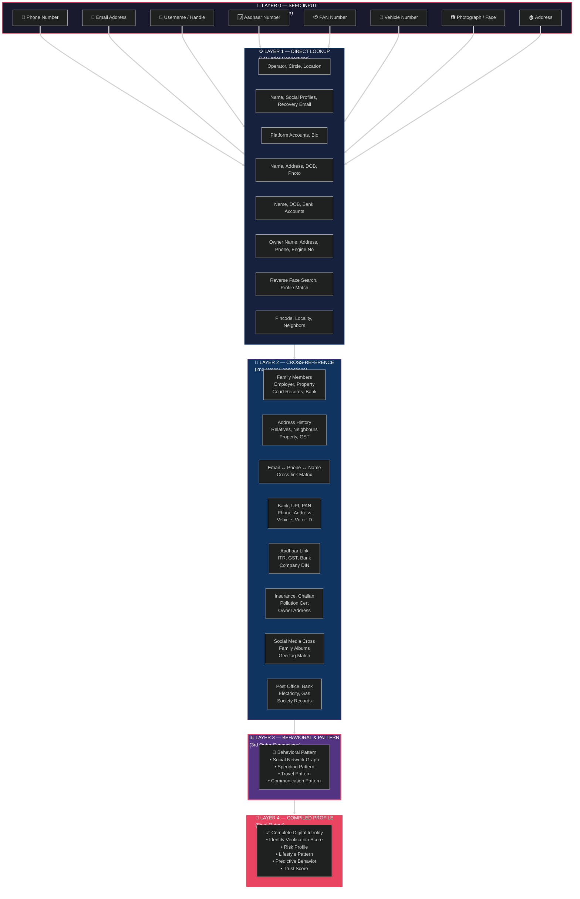

---

## 🔷 DIAGRAM 2: Detailed Cascade — Single Path Expansion (Phone Number → Full Profile)

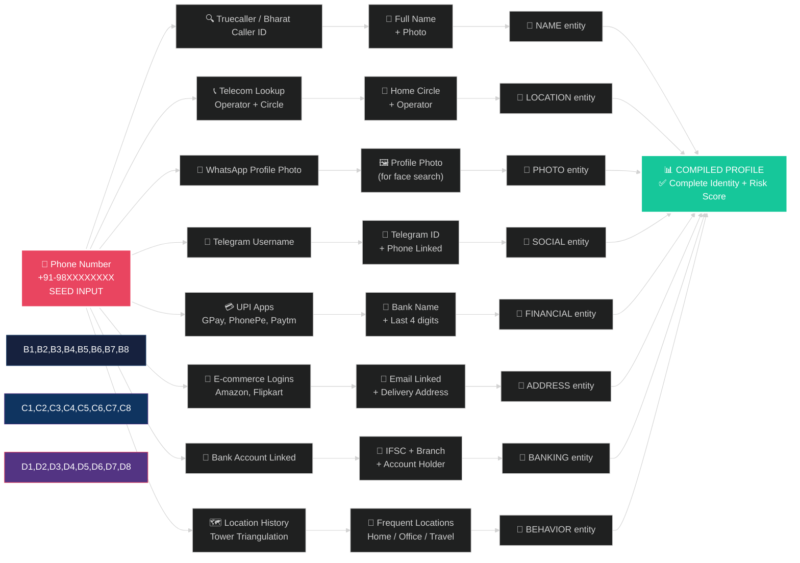

---

## 🔷 DIAGRAM 3: Deep Network — Aadhaar → Full Identity Graph

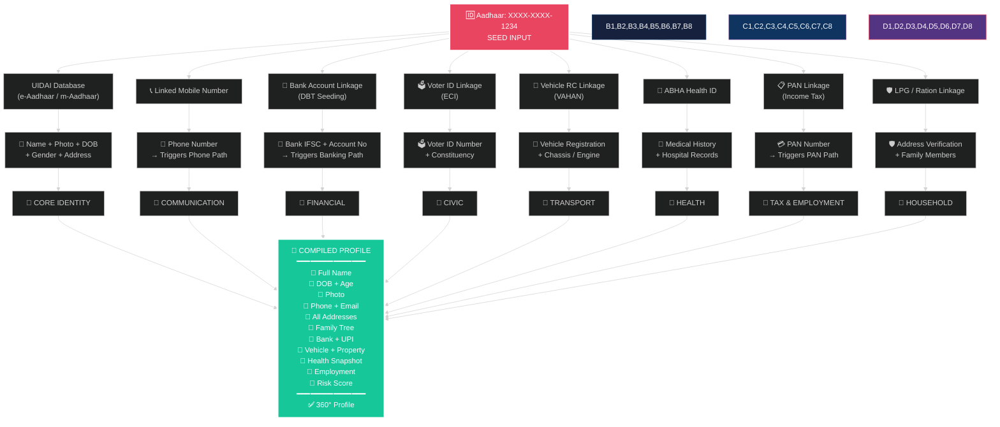

---

## 🔷 DIAGRAM 4: Email Address → Full Profile Cascade

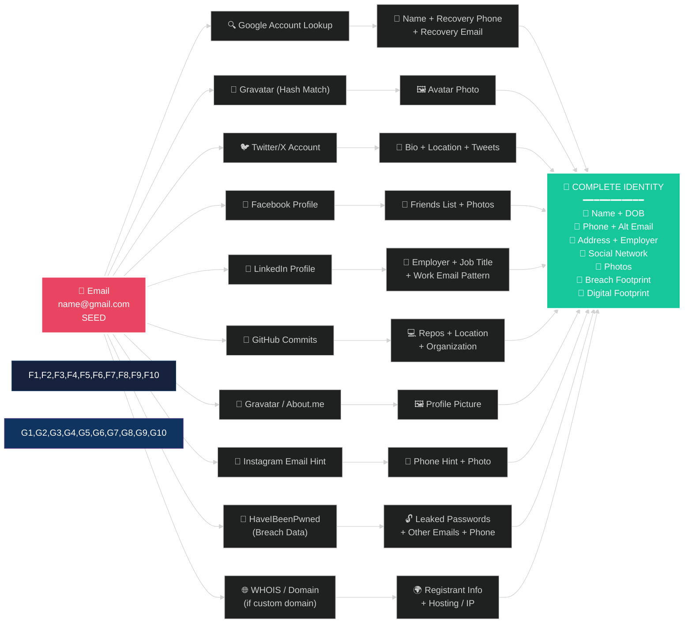

---

## 🔷 DIAGRAM 5: Username / Handle → Full Profile

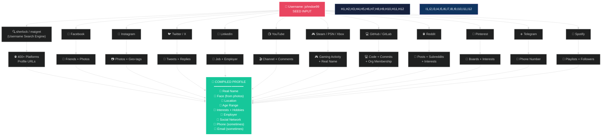

---

## 🔷 DIAGRAM 6: Vehicle Number → Owner Full Profile

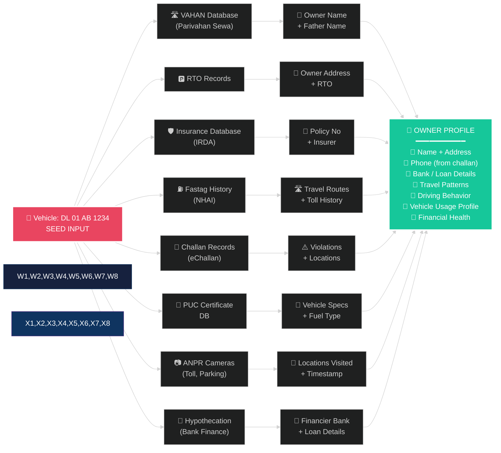

---

## 🔷 DIAGRAM 7: PAN Number → Financial + Identity Graph

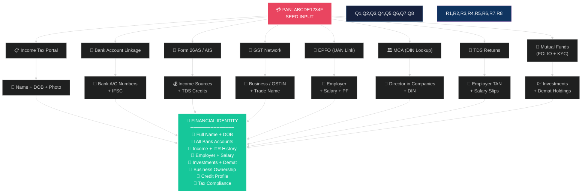

---

## 🔷 DIAGRAM 8: Address → Household + Locality Intelligence

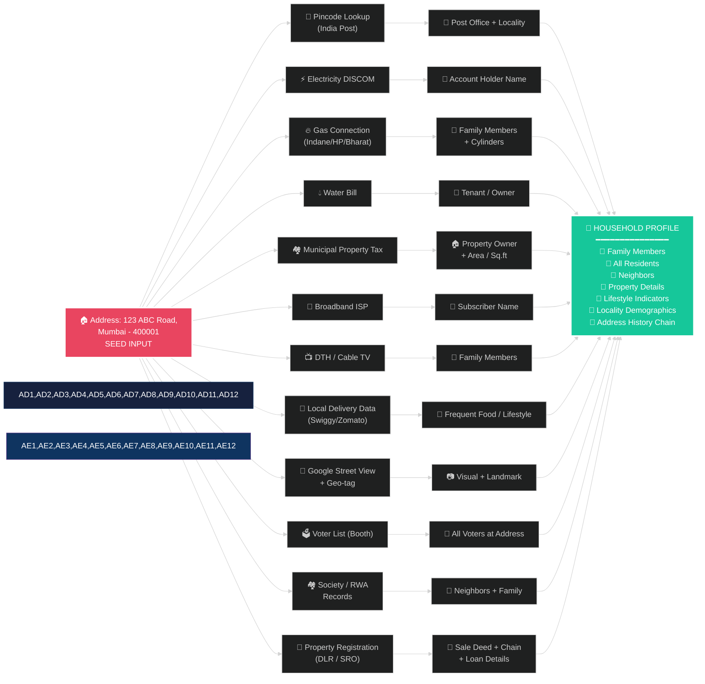

---

## 🔷 DIAGRAM 9: Photograph / Face → Reverse Intelligence

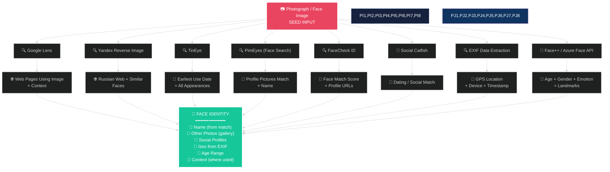

---

## 🔷 DIAGRAM 10: Full 360° Identity Graph (Knowledge Graph View)

```mermaid
%%{init: {'theme':'dark'}}%%
flowchart TB

    subgraph CORE["🎯 CORE IDENTITY ENTITY"]
        NAME["👤 Name<br/>+ DOB + Gender"]
        PHOTO["📷 Photo<br/>+ Signature"]
    end

    subgraph COMM["📡 COMMUNICATION"]
        PHONE["📱 Phone"]
        EMAIL["📧 Email"]
        SOCIAL["🌐 Social Profiles"]
    end

    subgraph ID["🆔 GOVERNMENT IDs"]
        AADHAR["🆔 Aadhaar"]
        PAN["💳 PAN"]
        VOTER["🗳️ Voter ID"]
        PASSPORT["📘 Passport"]
        DL["🚗 Driving Licence"]
    end

    subgraph FIN["🏦 FINANCIAL"]
        BANK["🏦 Bank A/C"]
        UPI["📲 UPI ID"]
        CARD["💳 Cards"]
        DEMAT["📊 Demat"]
        LOAN["💰 Loan"]
        ITR["📑 ITR"]
    end

    subgraph ADDR["🏠 ADDRESS"]
        HOME["🏠 Home"]
        WORK["🏢 Office"]
        PROP["🏘️ Property"]
    end

    subgraph VEH["🚗 VEHICLE & ASSETS"]
        CAR["🚗 Car / Bike"]
        INSURANCE["🛡️ Insurance"]
    end

    subgraph HEALTH["🏥 HEALTH"]
        ABHA["🩺 ABHA / MRN"]
        VACC["💉 Vaccination"]
    end

    subgraph PROF["💼 PROFESSIONAL"]
        EMP["🏢 Employer"]
        UAN["📋 UAN / EPF"]
    end

    subgraph FAM["👨‍👩‍👧 FAMILY"]
        FATHER["👨 Father"]
        MOTHER["👩 Mother"]
        SPOUSE["💑 Spouse"]
        CHILD["👶 Children"]
        REL["👥 Relatives"]
    end

    subgraph BEH["🧬 BEHAVIOR"]
        TRAVEL["✈️ Travel"]
        SHOP["🛒 Shopping"]
        COMM_B["💬 Communication"]
        SOCIAL_B["🌐 Social"]
    end

    NAME --- PHONE & EMAIL & AADHAR & PAN & HOME
    NAME --- FATHER & MOTHER & SPOUSE & EMP
    PHOTO --- SOCIAL
    AADHAR --- BANK & PHONE & ABHA & VOTER
    PAN --- BANK & ITR & DEMAT
    PHONE --- UPI & BANK & SOCIAL
    EMAIL --- SOCIAL & BANK
    HOME --- PROP & CAR
    EMP --- UAN & ITR
    BANK --- LOAN & CARD
    CAR --- INSURANCE
    SPOUSE --- CHILD & REL
    TRAVEL --- PASSPORT
    SHOP --- CARD & UPI
    SOCIAL_B --- SOCIAL & COMM_B

    style CORE fill:#e94560,stroke:#fff,stroke-width:3px,color:#fff
    style COMM fill:#16213e,stroke:#0f3460,color:#fff
    style ID fill:#0f3460,stroke:#533483,color:#fff
    style FIN fill:#533483,stroke:#e94560,color:#fff
    style ADDR fill:#16c79a,stroke:#fff,color:#000
    style VEH fill:#ff6b35,stroke:#fff,color:#fff
    style HEALTH fill:#06ffa5,stroke:#000,color:#000
    style PROF fill:#7209b7,stroke:#fff,color:#fff
    style FAM fill:#f72585,stroke:#fff,color:#fff
    style BEH fill:#3a0ca3,stroke:#fff,color:#fff
```

---

## 🔷 DIAGRAM 11: Data Sources — Where Each PII Layer Comes From

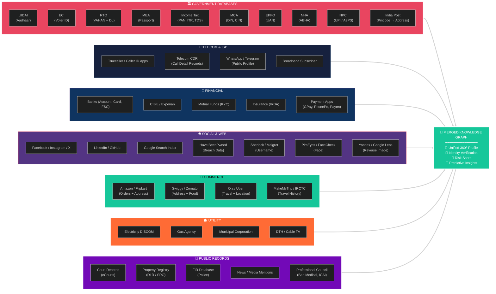

---

## 🔷 DIAGRAM 12: Neural Network Architecture (ML-Style Layered View)

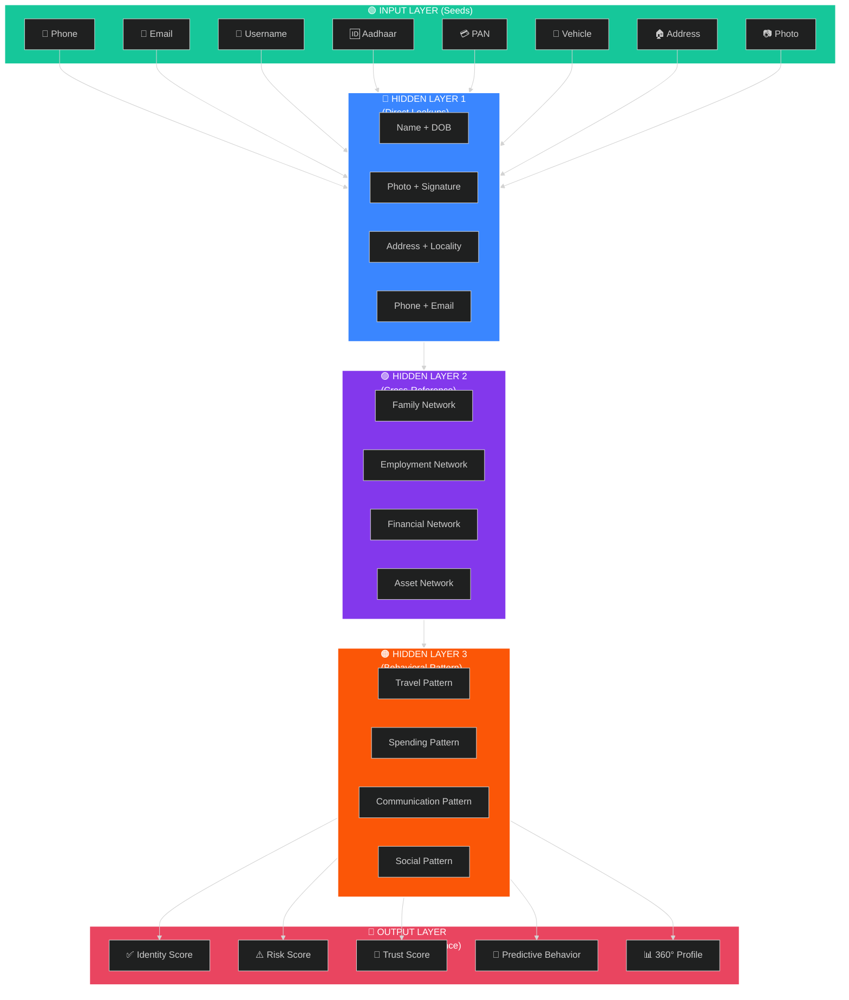

---

## 📊 Layer Architecture Summary

| Layer | Name | Function | Example Connections |
|-------|------|----------|---------------------|
| **L0** | Seed Input | Single identifier trigger | Phone, Email, Aadhaar, PAN |
| **L1** | Direct Lookup | 1st-order connections via APIs | Truecaller, UIDAI, GPay |
| **L2** | Cross-Reference | 2nd-order joins across DBs | Family, Address, Bank |
| **L3** | Behavioral Pattern | 3rd-order pattern detection | Travel, Spending, Social |
| **L4** | Compiled Profile | Final unified entity + scores | Risk Score, Trust Score, 360° |

---

## 🛡️ Privacy & Ethical Use Notes

> ⚠️ **This architecture represents legitimate OSINT / Identity Verification workflows** used by:
> - KYC / AML Compliance Teams
> - Fraud Detection Systems (Banks, Fintech)
> - Law Enforcement (with due process)
> - Background Verification (BGV) Vendors
> - Insurance Underwriting
> - Government Identity Schemes

> 🔐 **Defensive Use**: Use this same architecture to **map your organization's data exposure**, perform **DPIA**, design **consent flows**, and build **redaction systems**.

> 🚫 **Do NOT** use for:
> - Stalking / harassment
> - Unauthorized surveillance
> - Bypassing consent
> - Identity theft
> - Any illegal purpose under IT Act 2000 / DPDP Act 2023 / GDPR

---

*Total Diagrams: 12 • Total Layered Architecture: 5 layers • Seed Inputs: 8 • Data Sources: 30+ databases*
